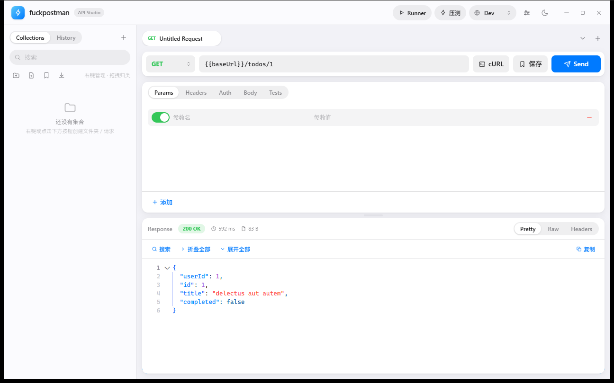
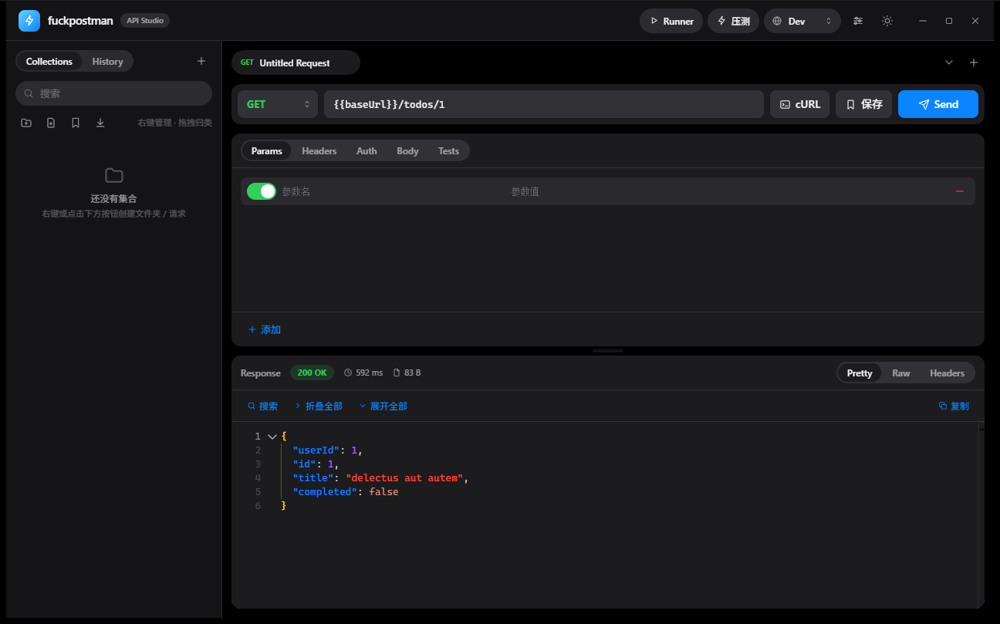
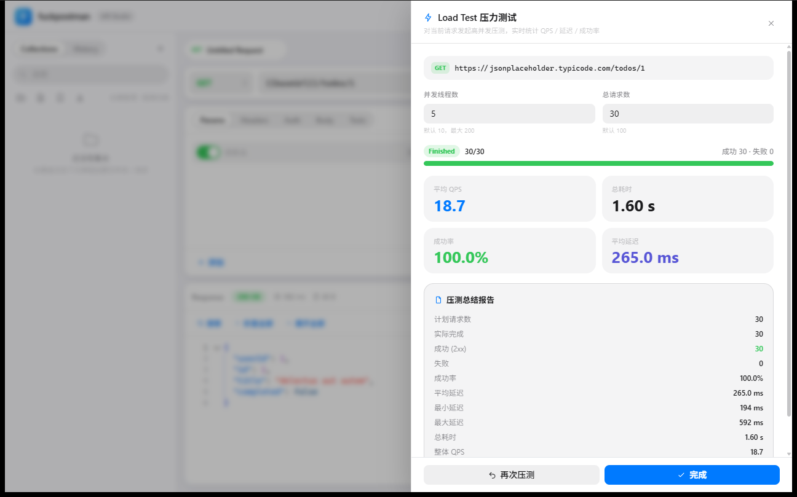

<div align="center">

# fuckpostman

**轻量级桌面 API 调试工具 · Postman 的开源替代**

基于 Tauri v2 + React + Rust 构建，iOS 风格界面，本地优先、隐私安全。

[](LICENSE)
[](https://tauri.app)
[](https://react.dev)
[](https://www.rust-lang.org)
[](#贡献指南)

</div>

---

## 简介

fuckpostman 是一个跨桌面的 API 调试客户端：编辑并发送 HTTP 请求、管理集合与环境、可视化断言、批量运行、SSE 流式接收、系统级密钥存储与并发压测，全部在一个轻量原生窗口中完成。

与浏览器版工具不同，**所有网络请求都由 Rust 后端（reqwest）发出**，WebView 只负责渲染与交互，因此天然绕过 CORS 与混合内容限制；**机密信息存放在操作系统密钥库**，绝不以明文落入本地缓存或导出文件。

## 界面预览

| 浅色 · 请求与响应 | 深色 · 请求与响应 |
| :---: | :---: |
|  |  |

| 压力测试实时大屏与总结报告 |
| :---: |
|  |

## 功能特性

- **请求编辑与发送**：Method / URL / Params / Headers / Auth（None、Bearer、Basic）/ Body（none、json、form-data、x-www-form-urlencoded、raw）；Monaco 编辑器支持折叠、括号匹配、JSON 校验与一键美化。
- **多页签**：拖拽排序、相同请求自动去重、溢出菜单（搜索 / 切换 / 关闭）。
- **Collections**：文件夹树、右键菜单、重命名 / 复制 / 删除、拖拽排序与跨文件夹移动、请求保存与导出。
- **环境变量**：多环境切换，`{{变量}}` 全链路替换（URL / Headers / Params / Body）。
- **cURL 导入**：粘贴 cURL 命令一键解析为请求。
- **History**：自动记录、关键字搜索、一键重放。
- **可视化断言（Tests）**：针对 status / time / json 路径，支持 eq、neq、lt、lte、gt、gte、contains、exists；发送后自动求值并在响应区展示。
- **Collection Runner**：按目录批量运行，CSV 数据驱动（列名注入为变量）、迭代间隔、JSON / CSV 报告导出。
- **Headers 联想输入**：常见 Header 名与值的自动补全。
- **SSE 流式接收**：`text/event-stream` 响应逐块实时打印（打字机视图），完整保留多字节 UTF-8 边界。
- **Secrets 安全存储**：机密写入 OS 密钥库（Windows Credential Manager / macOS Keychain / Linux Secret Service），以 `{{vault.名称}}` 引用，发送时由 Rust 动态注入；导出 Collection 自动脱敏。
- **Load Test 压力测试**：并发 1–200（默认 10）、总请求数可配；`JoinSet + Semaphore` 并发池 + 全局连接池；实时 QPS / 延迟 / 成功率大屏、进度条、中途停止（排空在飞请求）、总结报告。
- **iOS 风格 UI**：浅色 / 深色双主题、材质与动效、自定义标题栏。

## 技术栈

| 层 | 技术 |
| --- | --- |
| 桌面壳 | Tauri v2（Rust） |
| 前端 | React 18 + TypeScript 5 + Vite 5 |
| 状态 | Zustand（persist 本地持久化） |
| 样式 | Tailwind CSS 3（CSS 变量主题令牌） |
| 编辑器 | Monaco Editor |
| HTTP | reqwest 0.12（gzip / brotli / deflate / multipart） |
| 并发 | tokio（JoinSet / Semaphore / 定时事件） |
| 密钥 | keyring 3（OS 原生密钥库） |
| 对话框 | rfd（原生保存对话框） |

## 快速开始

### 环境要求

- **Node.js** ≥ 18
- **Rust** ≥ 1.77（stable，含 cargo）
- **Tauri v2 系统依赖**（按平台）：
  - Windows：WebView2 Runtime + Visual Studio Build Tools（MSVC）
  - macOS：Xcode Command Line Tools
  - Linux：webkit2gtk-4.1、libgtk-3 等，详见 [官方前置依赖](https://tauri.app/start/prerequisites/)

### 安装与开发

```bash
# 1. 克隆仓库
git clone <你的仓库地址> fuckpostman
cd fuckpostman

# 2. 安装前端依赖
npm install

# 3. 启动开发模式（自动拉起 Vite :1420 + Rust 调试窗口）
npm run tauri:dev
```

### 构建与打包

```bash
# 仅前端构建（含 tsc 类型检查）
npm run build

# 打包桌面安装包（产物在 src-tauri/target/release/bundle/）
npm run tauri:build
```

### 常用检查

```bash
npx tsc --noEmit          # 前端类型检查
cd src-tauri
cargo fmt --check         # Rust 格式
cargo clippy              # Rust lint
cargo build               # 仅编译后端
```

## 项目结构

```
├── src/                    # React 前端
│   ├── components/         # UI 组件（请求/响应/集合/Runner/压测/密钥/环境等）
│   ├── hooks/              # useSendRequest、usePointerDrag
│   ├── services/           # apiService：唯一 IPC 出口
│   ├── store/              # Zustand + persist（本地持久化）
│   ├── types/              # IPC 契约与领域模型（snake_case）
│   ├── utils/              # 断言/cURL/CSV/环境/集合/联想/格式化
│   ├── App.tsx
│   └── main.tsx
├── src-tauri/              # Rust 后端
│   ├── src/
│   │   ├── http.rs         # HTTP 引擎 + SSE 流式事件
│   │   ├── loadtest.rs     # 压测引擎（JoinSet + Semaphore）
│   │   ├── vault.rs        # OS 密钥库读写 / 注入 / 导出脱敏
│   │   └── lib.rs          # Tauri 命令注册
│   ├── capabilities/       # 窗口权限声明
│   └── tauri.conf.json     # 窗口 / 打包 / 标识配置
├── docs/screenshots/       # README 截图
├── index.html
└── package.json
```

## 架构说明

### 网络路径

WebView **不直接发起任何 fetch / XHR**。前端通过 `services/apiService.ts` 调用 Tauri Command，由 Rust 统一发出请求并回传结果：

```
React UI → apiService.invoke → Rust execute_request → reqwest → 目标服务
```

IPC 契约两侧均为 snake_case：

```ts
// 请求
{ method, url, headers, params, body_type, body, timeout_ms }
// 响应
{ status_code, status_text, headers, body, time_elapsed_ms, size_bytes }
```

### 实时事件

| 事件 | 用途 |
| --- | --- |
| `http-stream://{id}/meta` | SSE 响应开始（状态码 / 头） |
| `http-stream://{id}/chunk` | SSE 逐块文本 |
| `load-test://progress` | 压测实时进度与指标（约 300ms 一次） |

### 数据持久化

集合、环境、历史、主题、Secrets **名称** 通过 Zustand persist 存于 localStorage；页签为会话态。Secrets **值** 只存在于 OS 密钥库。

## 安全与隐私

- **机密零明文**：Secrets 值写入 OS 密钥库，localStorage / 历史 / UI 仅见名称与存在性标记。
- **运行时注入**：发送请求时由 Rust 解析 `{{vault.名称}}` 并注入 Header / Body，明文不回传 WebView。
- **导出脱敏**：导出 Collection 时自动把机密值替换为 `{{vault.名称}}` 占位符。
- **本地优先**：所有数据留在本机，无遥测、无云端同步。

## 常见问题

- **Windows 启动报 WebView2 缺失**：安装 [WebView2 Runtime](https://developer.microsoft.com/microsoft-edge/webview2/)。
- **端口 1420 被占用**：Vite 配置为 `strictPort`，会直接失败而非静默换端口；请释放 1420 或修改 `vite.config.ts` 与 `tauri.conf.json` 的 `devUrl`。
- **Windows 重新编译前请先退出应用**：运行中的 exe 会锁定文件，导致 `cargo build` 失败。
- **Linux 编译缺依赖**：参照 [Tauri 前置依赖](https://tauri.app/start/prerequisites/) 安装 webkit2gtk 等开发包。

## 贡献指南

欢迎 Issue 与 PR！

1. Fork 本仓库并创建特性分支：`git checkout -b feat/your-feature`。
2. 保持改动聚焦：一个 PR 只做一件事。
3. 提交前通过检查：`npx tsc --noEmit`、`cargo fmt`、`cargo clippy`。
4. 提交信息建议遵循 Conventional Commits（`feat:` / `fix:` / `docs:` / `refactor:` …）。
5. 推送分支并发起 Pull Request，描述动机与验证方式。

代码风格：前端 TypeScript 严格模式、函数组件 + Hooks；后端 Rust 遵循 rustfmt / clippy 默认规则。UI 沿用现有 iOS 设计令牌（见 `tailwind.config.js`），新增组件请复用 `.card` / `.field-ios` / `.btn-*` 等既有样式。

## 路线图

以下为规划方向，欢迎认领：

- [ ] 请求 / 集合导入导出兼容 Postman v2.1 格式
- [ ] WebSocket 调试
- [ ] 更多认证方式（OAuth 2.0、API Key 位置可选）
- [ ] 压测延迟分位数（P50 / P90 / P99）与图表

## 许可证

本项目基于 [MIT 许可证](LICENSE) 开源。

## 致谢

- [Tauri](https://tauri.app) — 轻量原生桌面壳
- [React](https://react.dev) / [Vite](https://vitejs.dev) — 前端框架与构建
- [Monaco Editor](https://microsoft.github.io/monaco-editor/) — 代码编辑体验
- [reqwest](https://github.com/seanmonstar/reqwest) / [tokio](https://tokio.rs) — Rust 异步网络与并发
- [keyring](https://github.com/hwchen/keyring-rs) — OS 密钥库抽象